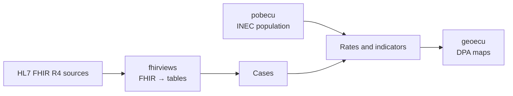

<h1 align="center">Dr. Fabricio Salas Guerrero</h1>

<p align="center"><strong>Physician epidemiologist bridging clinical practice, data and artificial intelligence</strong></p>
<p align="center"><sub>HL7 FHIR · SNOMED CT · LOINC · ICD-11 · DICOM · IHE · openEHR · GS1 Healthcare</sub></p>

<p align="center"><a href="https://github.com/f-slg">Español</a> · <strong>English</strong></p>

<p align="center">
  <a href="https://www.hl7ecuador.org/">HL7 Ecuador</a> ·
  <a href="https://www.linkedin.com/in/fslg/">LinkedIn</a> ·
  <a href="https://aipocrates.blog/">AIpócrates</a>
</p>

---

I chair **[HL7 Ecuador](https://www.hl7ecuador.org/)** and work in epidemiological surveillance at Ecuador's Ministry of Public Health. I build open tools that make health data **interoperable and reproducible**: from clinical standards (FHIR, FSH, SQL on FHIR) to data engineering (PostgreSQL, DuckDB, Python) and analytics (R, Shiny, Quarto).

## R packages

| Package | What it does | Status |
|---|---|---|
| [**fhirviews**](https://github.com/f-slg/fhirviews/blob/main/README.en.md) · [docs](https://f-slg.github.io/fhirviews/) | HL7 FHIR R4 client and SQL on FHIR (`ViewDefinition`, FHIRPath) engine that turns clinical resources into tables. Passes all 133 *shareable* tests of the official suite (a test result, not a certification). | **Submitted to CRAN** (v0.5.0)<br> [](https://github.com/f-slg/fhirviews/actions/workflows/R-CMD-check.yaml) [](https://f-slg.github.io/fhirviews/reference/vista_conformidad.html) |
| [**geoecu**](https://github.com/f-slg/geoecu/blob/main/README.en.md) · [docs](https://f-slg.github.io/geoecu/) | Ecuador's 24 provinces, 223 cantons and 1,048 parishes as `sf` objects, with official CONALI DPA codes. | **On CRAN** (v0.4.1)<br> [](https://cran.r-project.org/package=geoecu) [](https://github.com/f-slg/geoecu/actions/workflows/R-CMD-check.yaml) |
| [**pobecu**](https://github.com/f-slg/pobecu/blob/main/README.en.md) · [docs](https://f-slg.github.io/pobecu/) | INEC population (Revision 2024) by province, canton and parish, ready to use as the denominator of health rates. | **On CRAN** (v0.3.0)<br> [](https://cran.r-project.org/package=pobecu) [](https://github.com/f-slg/pobecu/actions/workflows/R-CMD-check.yaml) |

<sub>Function names and reference documentation are in Spanish; each English README includes a glossary.</sub>

They are independent but designed to work together: **from a case register to a map of rates** ([complete, reproducible example](https://f-slg.github.io/fhirviews/articles/tasas-pobecu.html), in Spanish).



```r
# install.packages(c("pobecu", "geoecu", "sf", "ggplot2"))   # from CRAN
library(pobecu)
library(ggplot2)

casos <- data.frame(dpa_canton = c("1101", "1102", "1110"), anio = 2025,
                    casos = c(120, 8, 15))          # made-up data
tasas <- pob_tasa(casos, "casos", por = 1e5)        # cases per 100,000

mapa <- pob_mapa("canton", anio = 2025, provincia = "Loja")   # geoecu layer
mapa <- merge(mapa, tasas[c("dpa_canton", "tasa")], by = "dpa_canton", all.x = TRUE)

ggplot(mapa) + geom_sf(aes(fill = tasa)) + theme_void()
```

<a href="https://github.com/f-slg/geoecu/blob/main/README.en.md#6-population-density-by-province-canton-and-parish">
  
</a>

<sub>Population density 2026: INEC population (via pobecu) / `area_km2` from geoecu. Boundaries: CONALI (CC BY).</sub>

## Learning and prototypes

- [**Aprende FHIR**](https://github.com/f-slg/aprende-fhir) · [site](https://f-slg.github.io/aprende-fhir/): HL7 FHIR R4 workshop in Spanish, with an Ecuadorian clinical case, for Postman, R or curl.
- [**Agenda FHIR**](https://github.com/f-slg/agenda-fhir-r): educational clinical scheduling prototype in R/Shiny, built with Catherine Solarte Godoy and Néstor Fabián López at HL7 Colombia's FHIR Camp.
- [**Peru immunisation situation room**](https://github.com/f-slg/sala-inmunizaciones-peru): educational situation room in R/Shiny and golem.

Public examples use synthetic or open data.

## Institutional work

Much of my work lives in private repositories: **HL7 FHIR R4 implementation guides for Ecuador** in FSH (draft), a **standards-based epidemiological surveillance platform** (HAPI FHIR, Kafka), surveillance of **healthcare-associated infections and outbreaks** (*medallion* ETL on PostgreSQL, Shiny dashboards) and an open book in preparation, *Data science with R for public health* (in Spanish).

## Background

- **HL7 Ecuador:** chair since 2025.
- **Ministry of Public Health of Ecuador:** epidemiologist and data analyst in national epidemiological surveillance.
- **Graduate teaching** in medical informatics and data analytics (Universidad UTE, Universidad Continental, IAEN).
- **Doctorate in Artificial Intelligence and Machine Learning** in progress, Walsh College (2025–2028).
- **Publications:** [database optimisation for epidemiological surveillance](https://doi.org/10.16921/pfr.v8i3.292) (*Práctica Familiar Rural*, 2023) · [effectiveness of COVID-19 vaccines in Ecuador](https://doi.org/10.1016/j.jvacx.2023.100404) (*Vaccine: X*, 2023).

## Collaboration

I am interested in collaborations on **FHIR, SQL on FHIR, R and reproducible public health data**, especially in Latin America. Academic or institutional proposals: [LinkedIn](https://www.linkedin.com/in/fslg/). Bugs or contributions: the *Issues* and *Pull Requests* of each repository, in English or Spanish.
