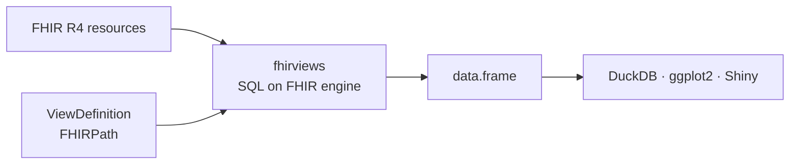
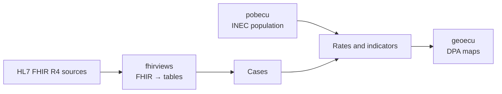

<h1 align="center">Dr. Fabricio Salas Guerrero</h1>

<p align="center"><strong>Physician epidemiologist bridging clinical practice, data and artificial intelligence</strong></p>
<p align="center">Clinical interoperability · Health data architecture and engineering · AI and digital health · Graduate teaching</p>
<p align="center"><sub>HL7 FHIR · SNOMED CT · LOINC · ICD-11 · DICOM · IHE · openEHR · GS1 Healthcare</sub></p>

<p align="center"><a href="https://github.com/f-slg">Español</a> · <strong>English</strong></p>

<p align="center">
  <a href="https://www.hl7ecuador.org/">HL7 Ecuador</a> ·
  <a href="https://www.linkedin.com/in/fslg/">LinkedIn</a> ·
  <a href="https://aipocrates.blog/">AIpócrates</a> ·
  <a href="https://github.com/f-slg?tab=repositories">Repositories</a>
</p>

---

### Closing the gap between clinical practice, data engineering and AI

I turn fragmented health systems into **interoperable, reproducible ecosystems** that deliver timely information for epidemiological surveillance, health management and public health decisions. What sets me apart is combining **clinical and epidemiological knowledge** with a technical profile in **data architecture and data science**.

I chair **[HL7 Ecuador](https://www.hl7ecuador.org/)**, promoting the adoption of interoperability standards and health data governance. An example of how I work: [from FHIR resources to a map of rates, step by step and reproducible](https://f-slg.github.io/fhirviews/articles/tasas-pobecu.html) (in Spanish).

<details>
<summary><strong>Technical stack</strong></summary>

<br>

I work end to end: from **clinical standards and terminologies** (FSH implementation guides, SQL on FHIR) to **data architecture and engineering** (HAPI FHIR, Kafka, PostgreSQL with a *medallion* architecture, DuckDB, Python ETL, Docker) and **analytics** (R, Shiny, Quarto, `sf`, forecasting and anomaly detection for surveillance). I mostly develop in R, Python, SQL and TypeScript.

</details>

<p align="center">
  <a href="#r-packages">Packages</a> ·
  <a href="#how-they-fit-together">Architecture</a> ·
  <a href="#learning-and-prototypes">Learning</a> ·
  <a href="#institutional-and-collaborative-work">Other work</a> ·
  <a href="#research-and-background">Research</a> ·
  <a href="#collaboration">Contact</a>
</p>

## R packages

| Package | What it does | Status |
|---|---|---|
| [**fhirviews**](https://github.com/f-slg/fhirviews/blob/main/README.en.md) | HL7 FHIR R4 client and SQL on FHIR (`ViewDefinition`) engine that turns clinical resources into tables. | **Submitted to CRAN** (v0.5.0) · DuckDB engine is experimental<br> [](https://github.com/f-slg/fhirviews/actions/workflows/R-CMD-check.yaml) [](https://f-slg.github.io/fhirviews/reference/vista_conformidad.html) |
| [**geoecu**](https://github.com/f-slg/geoecu/blob/main/README.en.md) | Ecuador's provinces, cantons and parishes as `sf` objects, with official CONALI DPA codes. | **On CRAN** (v0.4.1) · stable<br> [](https://cran.r-project.org/package=geoecu) [](https://github.com/f-slg/geoecu/actions/workflows/R-CMD-check.yaml) |
| [**pobecu**](https://github.com/f-slg/pobecu/blob/main/README.en.md) | INEC population by province, canton and parish, ready to use as the denominator of health rates. | **In development** · install from GitHub · 1900–2100 scenarios are experimental<br> [](https://github.com/f-slg/pobecu/actions/workflows/R-CMD-check.yaml) |

<sub>Each package has a README in Spanish and English. Function names and reference documentation are in Spanish; each English README includes a glossary.</sub>

### fhirviews — HL7 FHIR → analysis-ready tables

[Documentation](https://f-slg.github.io/fhirviews/) · [Architecture](https://f-slg.github.io/fhirviews/articles/arquitectura.html) · [Conformance](https://f-slg.github.io/fhirviews/reference/vista_conformidad.html)

Query **FHIR R4** servers from R and RStudio (paged search, CRUD, transactions, `$everything`, `$export`, SMART on FHIR) and turn resources into `data.frame`s with **ViewDefinition** and **FHIRPath**. An experimental **DuckDB** engine processes millions of resources from NDJSON or Parquet. It passes all 133 *shareable* tests of the official SQL on FHIR suite (an implementation test result, not an external certification).



### geoecu — official boundaries as sf objects

[Documentation](https://f-slg.github.io/geoecu/) · [Map gallery](https://f-slg.github.io/geoecu/articles/galeria.html)

**24 provinces, 223 cantons and 1,048 parishes** that nest without gaps or overlaps, in two resolutions, with `area_km2`, joins by DPA code (`geoecu_unir()`), conversion of historical codes (`actualizar_codigo()`) and a verified cache for offline use.

<table>
  <tr>
    <td width="33%"><a href="https://github.com/f-slg/geoecu/blob/main/README.en.md#map-gallery"></a></td>
    <td width="33%"><a href="https://github.com/f-slg/geoecu/blob/main/README.en.md#map-gallery"></a></td>
    <td width="34%"><a href="https://github.com/f-slg/geoecu/blob/main/README.en.md#map-gallery"></a></td>
  </tr>
  <tr>
    <td align="center"><sub>Provinces · natural regions</sub></td>
    <td align="center"><sub>Cantons · parishes per canton</sub></td>
    <td align="center"><sub>Parishes · detail of Puyango</sub></td>
  </tr>
</table>

<sub>Source: CONALI, Political-Administrative Division (open data, CC BY). Map labels are in Spanish. Galápagos is relocated for display only.</sub>

### pobecu — denominators for health indicators

[Documentation](https://f-slg.github.io/pobecu/) · [Methodology](https://f-slg.github.io/pobecu/articles/metodologia.html) · [Maps with geoecu](https://f-slg.github.io/pobecu/articles/pobecu-geoecu.html)

Official **INEC (Revision 2024)** estimates and projections: national 1950–2050, provincial 1990–2035 and cantonal 2010–2035 by sex, age and urban/rural area, plus pobecu's own **parish-level estimate** for 2010–2035, consistent with the canton total. Compute rates in one line with `pob_tasa()` and harmonise CONALI codes with 2022 Census units. **More than six million cells** were audited against the INEC spreadsheets with zero differences ([validation](https://github.com/f-slg/pobecu/tree/main/validacion)).

<a href="https://github.com/f-slg/pobecu/blob/main/README.en.md">
  
</a>

<sub>Source: INEC, Revision 2024. Parish figures are pobecu estimates, not official figures.</sub>

## How they fit together

**Interoperable clinical data + population denominators + administrative geography.** The packages are independent but designed to work together:



From a case register to a map of rates. The **[complete, reproducible example](https://f-slg.github.io/fhirviews/articles/tasas-pobecu.html)** (in Spanish) starts from synthetic FHIR resources and ends with the map; here is the short version:

```r
library(pobecu)   # INEC denominators
library(ggplot2)

casos <- data.frame(dpa_canton = c("1101", "1102", "1110"), anio = 2025,
                    casos = c(120, 8, 15))          # made-up data
tasas <- pob_tasa(casos, "casos", por = 1e5)        # cases per 100,000

mapa <- pob_mapa("canton", anio = 2025, provincia = "Loja")   # geoecu layer
mapa <- merge(mapa, tasas[c("dpa_canton", "tasa")], by = "dpa_canton", all.x = TRUE)

ggplot(mapa) + geom_sf(aes(fill = tasa)) + theme_void()
```

<a href="https://github.com/f-slg/geoecu/blob/main/README.en.md#6-population-density-by-province-canton-and-parish">
  
</a>

<sub>Population density 2026: INEC population (via pobecu) / `area_km2` from geoecu.</sub>

## Learning and prototypes

| Project | What it is |
|---|---|
| [**Aprende FHIR**](https://github.com/f-slg/aprende-fhir) · [site](https://f-slg.github.io/aprende-fhir/) | Step-by-step HL7 FHIR R4 workshop in Spanish, with one card per resource and an Ecuadorian clinical case, for Postman, R or curl. |
| [**Agenda FHIR**](https://github.com/f-slg/agenda-fhir-r) | Educational prototype of a clinical scheduling app in R/Shiny with FHIR resources and synthetic data, built with Catherine Solarte Godoy and Néstor Fabián López at HL7 Colombia's FHIR Camp. |
| [**sql-on-fhir.js**](https://github.com/f-slg/sql-on-fhir.js) | My fork of the SQL on FHIR reference implementation, used to contribute the fhirviews conformance report. |

Public examples use synthetic or open data. Prototypes are educational and do not replace institutional validation or clinical certification.

## Institutional and collaborative work

Much of my work lives in private or shared repositories not listed above:

- **HL7 FHIR R4 implementation guides for Ecuador**, written in FSH: base profiles, interoperability and a master patient index with IHE profiles. Draft.
- **Standards-based epidemiological surveillance platform**: validated ingestion, HAPI FHIR repository, Kafka events (CloudEvents), rules engine and alert workflow. Tested with synthetic data.
- **Surveillance of healthcare-associated infections and outbreaks**: Python validation engine, *medallion* ETL on PostgreSQL and Shiny dashboards using geoecu.
- **Health situation room** in R/Shiny on PostgreSQL and Docker, with endemic channels, ARIMA forecasts, anomaly detection and automatic PDF reports.
- **Open book in preparation**: *Data science with R for public health* (in Spanish), built with Quarto, with cases from Ecuador and Latin America.
- **Collaborative research** on big data and artificial intelligence in health.

## Research and background

- **HL7 Ecuador:** chair since 2025 (previously co-chair), promoting semantic and syntactic interoperability standards. [HL7 Ecuador chapter](https://www.hl7ecuador.org/) · [Activity](https://www.linkedin.com/company/hl7-ecuador/).
- **Ministry of Public Health of Ecuador:** epidemiologist and data analyst in national epidemiological surveillance; previously district health director and primary care physician in Loja.
- **Graduate teaching** in medical informatics, data analytics and health information systems (Universidad UTE, Universidad Continental) and in the IAEN School of Public Health telemedicine course.
- **Universidad Nacional de Loja:** [Cienf 2026 scientific committee](https://unl.edu.ec/cienf2026/comite-cientifico).
- Villagrán Pancho LE, **Salas Guerrero RF**, et al. *Metodología en la optimización de bases de datos de los sistemas de información en salud de Ecuador para el monitoreo en tiempo real de eventos críticos para la vigilancia epidemiológica* [Methodology for optimising Ecuador's health information system databases for real-time monitoring of critical events in epidemiological surveillance]. **Práctica Familiar Rural** (2023). [DOI: 10.16921/pfr.v8i3.292](https://doi.org/10.16921/pfr.v8i3.292).
- Pérez-Tasigchana F, et al. (including **Ronald Salas**). *Effectiveness of COVID-19 vaccines in Ecuador: A test-negative design*. **Vaccine: X** 15 (2023), 100404. [DOI: 10.1016/j.jvacx.2023.100404](https://doi.org/10.1016/j.jvacx.2023.100404) · [PubMed](https://pubmed.ncbi.nlm.nih.gov/38033879/).

<details>
<summary><strong>Education</strong></summary>

- MD and MSc in Epidemiology, Universidad Nacional de Loja.
- **Doctorate in Artificial Intelligence and Machine Learning in progress**, Walsh College (2025–2028).
- Postgraduate Program in Artificial Intelligence and Machine Learning: Business Applications, The University of Texas at Austin (2025).
- SNOMED CT Foundation course, SNOMED International (2026). FHIR Camp, HL7 Colombia (2026).
- Training in healthcare management, telemedicine, interoperability and data science.

Up-to-date academic history, positions and certifications on [LinkedIn](https://www.linkedin.com/in/fslg/).

</details>

<details>
<summary><strong>Writing (in Spanish)</strong></summary>

- [AI-based interoperability: the new Tower of Babel?](https://aipocrates.blog/2025/03/09/la-interoperabilidad-basada-en-inteligencia-artificial-la-nueva-torre-de-babel/)
- [The physician, AI and the quantum highway (Part 1)](https://aipocrates.blog/2025/08/03/el-medico-la-ia-y-la-autopista-cuantica-repensando-el-futuro-de-la-medicina-desde-la-interoperabilidad-sistemica-parte-1-2/)
- [AIpócrates](https://aipocrates.blog/): essays on AI, standards and the transformation of health care.

</details>

## Collaboration

I am interested in collaborations combining **FHIR, SQL on FHIR, R, reproducible public data and territorial health intelligence**, especially in Latin America.

Academic or institutional proposals: [LinkedIn](https://www.linkedin.com/in/fslg/). Bugs or code contributions: the *Issues* and *Pull Requests* of each repository, in English or Spanish.

<p align="center"><sub>Open projects · Identified sources · Synthetic data in demos · Reproducible documentation</sub></p>
