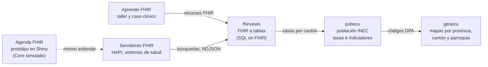

<h1 align="center">Dr. Fabricio Salas Guerrero</h1>

<strong>Médico epidemiólogo · Salud digital · Interoperabilidad · Inteligencia artificial</strong>

HL7 Ecuador · Miembro de AIpócrates

  <a href="https://www.linkedin.com/in/fslg/">LinkedIn</a> ·
  <a href="#trayectoria-y-participación-profesional">Trayectoria</a> ·
  <a href="#publicaciones-y-divulgación">Publicaciones</a> ·
  <a href="#proyecto-destacado-fhirviews">fhirviews</a> ·
  <a href="#proyectos">Proyectos</a>

---

## Sobre mí

Soy médico epidemiólogo y trabajo en la intersección de la **salud pública, la gestión sanitaria y la tecnología**. Mi trayectoria combina el análisis de información para la vigilancia epidemiológica con la salud digital, la telemedicina y la interoperabilidad de los sistemas de información.

Como presidente de **HL7 Ecuador**, participo en espacios de formación y colaboración para impulsar la adopción de estándares y conectar a profesionales clínicos, equipos técnicos e instituciones. Mi trabajo también incluye divulgación sobre inteligencia artificial y su relación con la información clínica. [Trayectoria pública](https://unl.edu.ec/cienf2026/comite-cientifico).

En GitHub comparto la parte práctica de este recorrido: prototipos, ejemplos documentados y aprendizajes que conectan los flujos clínicos con los datos. Iré incorporando mis proyectos de forma progresiva, con su documentación y ejemplos de uso.

## Áreas de trabajo

| Área | Enfoque |
|---|---|
| **Epidemiología y salud pública** | Vigilancia epidemiológica, análisis de información y uso de datos para apoyar decisiones sanitarias. |
| **Interoperabilidad en salud** | Modelado de recursos, continuidad de la información y adopción de estándares HL7 FHIR. |
| **Salud digital y telemedicina** | Conexión entre procesos asistenciales, sistemas de información y servicios de salud. |
| **Inteligencia artificial aplicada a salud** | Relación entre IA, calidad de datos, interoperabilidad y evaluación de su utilidad clínica. |
| **Gestión sanitaria** | Articulación entre necesidades de los servicios, información y transformación digital. |
| **Formación y divulgación** | Intercambio de conocimientos entre profesionales de salud, tecnología y academia. |

## Trayectoria y participación profesional

- **Presidente de HL7 Ecuador.** Participación en iniciativas de interoperabilidad y formación sobre estándares de información en salud. Mi contribución al panorama de FHIR en Ecuador figura en el informe [State of FHIR 2026](https://simplifier.net/jurisdictions/EC).
- **Miembro de AIpócrates y de la Organización Internacional de Telemedicina**, según la [biografía institucional de la Universidad Nacional de Loja](https://unl.edu.ec/cienf2026/comite-cientifico).
- **Experiencia en vigilancia y sistemas de información de salud pública.** Coautor de un trabajo sobre optimización de bases de datos para el seguimiento de eventos epidemiológicos en Ecuador, publicado con afiliación al Ministerio de Salud Pública. [Publicación de 2023](https://practicafamiliarrural.org/index.php/pfr/article/view/292).
- **Participación como ponente** en espacios académicos sobre interoperabilidad, HL7 FHIR, SNOMED CT e inteligencia artificial en salud. [Programa de la Universidad de Cuenca, 2026](https://www.ucuenca.edu.ec/wp-content/uploads/2026/05/CRONOGRAMA-FINAL-2.2.pdf).

## Formación

Mi formación reúne **medicina, epidemiología y gerencia en salud**, junto con estudios de posgrado en inteligencia artificial y aprendizaje automático.

La biografía de la [Universidad Nacional de Loja](https://unl.edu.ec/cienf2026/comite-cientifico) recoge la maestría en Gerencia en Salud y la formación de posgrado en IA y ML. En mi [perfil profesional de LinkedIn](https://www.linkedin.com/in/fslg/) se detallan la trayectoria académica y las certificaciones, incluyendo formación en IA y aprendizaje automático de The University of Texas at Austin y fundamentos de HL7 FHIR.

## Publicaciones y divulgación

### Sistemas de información para la vigilancia epidemiológica · 2023

Coautor de un reporte de implementación sobre optimización de bases de datos de salud en Ecuador para mejorar el monitoreo de eventos epidemiológicos, con atención a arbovirosis y malaria. Publicado en **Práctica Familiar Rural**, volumen 8, número 3.

[Leer el artículo](https://practicafamiliarrural.org/index.php/pfr/article/view/292) · [DOI: 10.16921/pfr.v8i3.292](https://doi.org/10.16921/pfr.v8i3.292)

### Interoperabilidad e inteligencia artificial · 2025

En AIpócrates comparto reflexiones sobre la fragmentación de la información sanitaria, la necesidad de estándares comunes y la relación entre la práctica médica y las nuevas tecnologías.

- [La interoperabilidad basada en inteligencia artificial: ¿La nueva torre de Babel?](https://aipocrates.blog/2025/03/09/la-interoperabilidad-basada-en-inteligencia-artificial-la-nueva-torre-de-babel/)
- [El médico, la IA y la autopista cuántica — Parte 1](https://aipocrates.blog/2025/08/03/el-medico-la-ia-y-la-autopista-cuantica-repensando-el-futuro-de-la-medicina-desde-la-interoperabilidad-sistemica-parte-1-2/)

## Proyecto destacado: fhirviews

[**fhirviews**](https://github.com/f-slg/fhirviews) lleva **HL7 FHIR R4** a R: un cliente para consultar cualquier servidor FHIR desde R y RStudio, al estilo de Postman, y un motor que convierte los recursos FHIR en tablas con el estándar **[SQL on FHIR](https://sql-on-fhir.org/)** (`ViewDefinition`). El motor de vistas funciona dentro de R, sin Java ni Spark, y devuelve `data.frame` listos para analizar.

- **Conforme al estándar:** pasa las **133 pruebas *shareable*** del banco oficial de SQL on FHIR, que se ejecuta en cada comprobación de integración continua.
- **Del servidor a la tabla:** búsqueda con paginación, lectura y escritura, transacciones, `$everything`, `$validate` y exportación masiva con `$export` (FHIR Bulk Data), con errores legibles a partir del `OperationOutcome`.
- **Listo para servidores de producción:** autenticación SMART on FHIR / OAuth2 (*client credentials*, *Backend Services* con JWT firmado e inicio de sesión en el navegador), con renovación automática del token.
- **Pensado para grandes volúmenes:** un segundo motor traduce las vistas a SQL de DuckDB y procesa **un millón de pacientes en unos 5,5 segundos** en un portátil, con las mismas tablas que el motor principal; vistas guardadas en DuckDB para consultarlas con SQL y unión con [pobecu](https://github.com/f-slg/pobecu) para calcular tasas por cantón.
- **Para enseñar y explorar:** panel *Connections* y addins de RStudio, y el caso clínico de [Aprende FHIR](https://github.com/f-slg/aprende-fhir) incluido como datos de ejemplo.

[Repositorio](https://github.com/f-slg/fhirviews) · [Documentación](https://f-slg.github.io/fhirviews/) · [Versión 0.2.0](https://github.com/f-slg/fhirviews/releases/tag/v0.2.0) · [Cómo funciona por dentro](https://f-slg.github.io/fhirviews/articles/arquitectura.html)

## Proyectos

Este espacio reúne proyectos sobre salud, datos y tecnología. La colección irá creciendo a medida que publique nuevos repositorios.

| | Proyecto | Descripción | Tecnologías |
|:---:|---|---|---|
|  | [**fhirviews**](https://github.com/f-slg/fhirviews) | Paquete de R para usar HL7 FHIR R4 desde R y RStudio como en Postman y convertir los recursos en tablas con SQL on FHIR (`ViewDefinition`). Motor de vistas en R, sin Java ni Spark, más un motor DuckDB para millones de recursos; SMART on FHIR y `$export`; 133/133 pruebas *shareable* del banco oficial. | R, HL7 FHIR R4, SQL on FHIR, FHIRPath, DuckDB, OAuth2 |
|  | [**geoecu**](https://github.com/f-slg/geoecu) | Paquete de R con las capas geográficas de provincias, cantones y parroquias del Ecuador, con códigos DPA, listas para mapear y unir con datos de salud. | R, sf, ggplot2 |
|  | [**pobecu**](https://github.com/f-slg/pobecu) | Paquete de R con la población del Ecuador por provincia, cantón y parroquia (INEC, 1950-2050), para calcular tasas, coberturas e indicadores. | R, sf, ggplot2 |
|  | [**Agenda FHIR**](https://github.com/f-slg/agenda-fhir-r) | Prototipo educativo de FHIR TEAM para explorar el agendamiento y la atención clínica con datos sintéticos y un Core simulado. | R, Shiny, HL7 FHIR R4 |
|  | [**Aprende FHIR**](https://github.com/f-slg/aprende-fhir) | Taller de HL7 FHIR R4 en español, paso a paso: cada recurso explicado con su ficha y construido campo por campo, siguiendo un caso clínico ecuatoriano. Para Postman, R o curl. | HL7 FHIR R4, Postman, R |

Los proyectos forman un flujo de trabajo completo, del dato clínico estandarizado al indicador territorial:

geoecu y pobecu comparten los mismos códigos de la División Político-Administrativa, así que funcionan juntos: con pocas líneas se obtiene un mapa de tasas o de densidad por cantón o parroquia. Con fhirviews, los datos que vienen de un servidor FHIR se convierten en las tablas de casos que pobecu necesita para calcular esas tasas.

[Explorar mis repositorios](https://github.com/f-slg?tab=repositories)

## Herramientas en este espacio

**R · Shiny · sf · ggplot2 · HL7 FHIR R4 · SQL on FHIR · FHIRPath · JSON · DuckDB · JavaScript (V8) · testthat · pkgdown · Git · GitHub Actions**

Los proyectos se acompañan de documentación sobre su funcionamiento, decisiones de diseño y limitaciones: sitios de documentación y ejemplos de uso, notas sobre las fuentes de los datos y, en los paquetes de R (geoecu, pobecu y fhirviews), pruebas automáticas en Windows, macOS y Linux.

## Conectemos

Me interesa el intercambio entre medicina, epidemiología, gestión e informática en salud. Para conversar sobre estos temas, puedes encontrarme en [LinkedIn](https://www.linkedin.com/in/fslg/). Las sugerencias y propuestas de colaboración pueden compartirse en los repositorios correspondientes.
