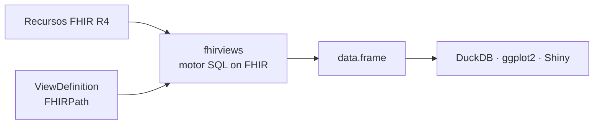
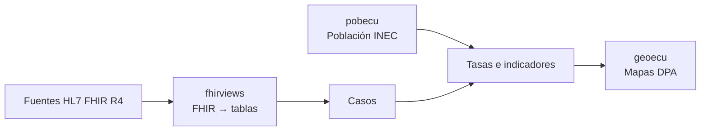

<h1 align="center">Dr. Fabricio Salas Guerrero</h1>

<p align="center"><strong>Médico epidemiólogo que une clínica, datos e inteligencia artificial</strong></p>
<p align="center">Interoperabilidad clínica · Arquitectura e ingeniería de datos en salud · IA y salud digital · Docencia de posgrado</p>
<p align="center"><sub>HL7 FHIR · SNOMED CT · LOINC · CIE-11 · DICOM · IHE · openEHR · GS1 Healthcare</sub></p>

<p align="center"><strong>Español</strong> · <a href="https://github.com/f-slg/f-slg/blob/main/README.en.md">English</a></p>

<p align="center">
  <a href="https://www.hl7ecuador.org/">HL7 Ecuador</a> ·
  <a href="https://www.linkedin.com/in/fslg/">LinkedIn</a> ·
  <a href="https://aipocrates.blog/">AIpócrates</a> ·
  <a href="https://github.com/f-slg?tab=repositories">Repositorios</a>
</p>

---

### Cierro la brecha entre la práctica clínica, la ingeniería de datos y la IA

Transformo sistemas de salud fragmentados en **ecosistemas interoperables, seguros y escalables**, capaces de generar información oportuna para la vigilancia epidemiológica, la gestión sanitaria y las decisiones en salud pública. Mi diferencial es combinar el **conocimiento clínico y epidemiológico** con un perfil técnico en **arquitectura y ciencia de datos**.

Presido **[HL7 Ecuador](https://www.hl7ecuador.org/)**, donde impulso la adopción de estándares de interoperabilidad y gobernanza de datos en salud. Trabajo de punta a punta: desde **estándares clínicos y terminologías** (guías de implementación en FSH, SQL on FHIR) hasta **arquitectura e ingeniería de datos** (HAPI FHIR, Kafka, PostgreSQL con arquitectura *medallion*, DuckDB, ETL en Python, Docker) y **analítica** (R, Shiny, Quarto, `sf`, pronóstico y detección de anomalías para vigilancia). Desarrollo sobre todo en R, Python, SQL y TypeScript.

<p align="center">
  <a href="#paquetes-de-r">Paquetes</a> ·
  <a href="#cómo-se-relacionan">Arquitectura</a> ·
  <a href="#aprendizaje-y-prototipos">Aprendizaje</a> ·
  <a href="#trabajo-institucional-y-colaborativo">Otros proyectos</a> ·
  <a href="#investigación-y-trayectoria">Investigación</a> ·
  <a href="#colaboración">Contacto</a>
</p>

## Paquetes de R

| Paquete | Para qué sirve | Estado |
|---|---|---|
| [**fhirviews**](https://github.com/f-slg/fhirviews) | Cliente HL7 FHIR R4 y motor SQL on FHIR (`ViewDefinition`) que convierte recursos clínicos en tablas. | **Enviado a CRAN** (v0.5.0) · motor DuckDB experimental<br> [](https://github.com/f-slg/fhirviews/actions/workflows/R-CMD-check.yaml) [](https://f-slg.github.io/fhirviews/reference/vista_conformidad.html) |
| [**geoecu**](https://github.com/f-slg/geoecu) | Provincias, cantones y parroquias del Ecuador como objetos `sf`, con códigos DPA del CONALI. | **En CRAN** (v0.4.1) · estable<br> [](https://cran.r-project.org/package=geoecu) [](https://github.com/f-slg/geoecu/actions/workflows/R-CMD-check.yaml) |
| [**pobecu**](https://github.com/f-slg/pobecu) | Población del INEC por provincia, cantón y parroquia, lista para usar como denominador de tasas. | **En desarrollo** · se instala desde GitHub · escenarios 1900–2100 experimentales<br> [](https://github.com/f-slg/pobecu/actions/workflows/R-CMD-check.yaml) |

<sub>Cada paquete tiene su README en español y en inglés. Las funciones y la documentación de referencia están en español.</sub>

### fhirviews — HL7 FHIR → tablas analíticas

[Documentación](https://f-slg.github.io/fhirviews/) · [Arquitectura](https://f-slg.github.io/fhirviews/articles/arquitectura.html) · [Conformidad](https://f-slg.github.io/fhirviews/reference/vista_conformidad.html)

Consulta servidores **FHIR R4** desde R y RStudio (búsqueda con paginación, CRUD, transacciones, `$everything`, `$export`, SMART on FHIR) y transforma los recursos en `data.frame` con **ViewDefinition** y **FHIRPath**. Incluye un motor experimental sobre **DuckDB** para millones de recursos en NDJSON o Parquet. Supera las 133 pruebas *shareable* de la suite oficial de SQL on FHIR. Es un resultado de pruebas de implementación, no una certificación externa.



### geoecu — cartografía oficial como objetos sf

[Documentación](https://f-slg.github.io/geoecu/) · [Galería cartográfica](https://f-slg.github.io/geoecu/articles/galeria.html)

**24 provincias, 223 cantones y 1.048 parroquias** que encajan sin huecos ni traslapes, en dos resoluciones, con superficie `area_km2`, unión por código DPA (`geoecu_unir()`), conversión de códigos históricos (`actualizar_codigo()`) y caché verificada para trabajar sin conexión.

<table>
  <tr>
    <td width="33%"><a href="https://github.com/f-slg/geoecu#1-provincias-regiones-naturales-y-límites"></a></td>
    <td width="33%"><a href="https://github.com/f-slg/geoecu#2-cantones-parroquias-por-cantón"></a></td>
    <td width="34%"><a href="https://github.com/f-slg/geoecu#3-parroquias-mapa-nacional-y-detalle-de-puyango"></a></td>
  </tr>
  <tr>
    <td align="center"><sub>Provincias · regiones naturales</sub></td>
    <td align="center"><sub>Cantones · parroquias por cantón</sub></td>
    <td align="center"><sub>Parroquias · detalle de Puyango</sub></td>
  </tr>
</table>

<sub>Fuente: CONALI, División Político-Administrativa (datos abiertos, CC BY). Galápagos se reubica solo para visualización.</sub>

### pobecu — denominadores para indicadores de salud

[Documentación](https://f-slg.github.io/pobecu/) · [Metodología](https://f-slg.github.io/pobecu/articles/metodologia.html) · [Mapas con geoecu](https://f-slg.github.io/pobecu/articles/pobecu-geoecu.html)

Estimaciones y proyecciones oficiales del **INEC (Revisión 2024)**: nacional 1950–2050, provincial 1990–2035 y cantonal 2010–2035 por sexo, edad y área urbana/rural, más una **estimación parroquial propia** 2010–2035 coherente con el total cantonal. Calcula tasas en una línea con `pob_tasa()` y homologa códigos CONALI con los del Censo 2022. Se auditaron **más de seis millones de celdas** contra los Excel del INEC, sin diferencias ([validación](https://github.com/f-slg/pobecu/tree/main/validacion)).

<a href="https://github.com/f-slg/pobecu">
  
</a>

<sub>Fuente: INEC, Revisión 2024. Las cifras parroquiales son estimaciones de pobecu, no cifras oficiales.</sub>

## Cómo se relacionan

**Datos clínicos interoperables + denominadores poblacionales + geografía administrativa.** Los paquetes son independientes, pero están pensados para usarse juntos:



Del registro de casos a un mapa de tasas. El **[ejemplo completo y reproducible](https://f-slg.github.io/fhirviews/articles/tasas-pobecu.html)** parte de recursos FHIR sintéticos y llega al mapa; aquí, la versión corta:

```r
library(pobecu)   # denominadores del INEC
library(ggplot2)

casos <- data.frame(dpa_canton = c("1101", "1102", "1110"), anio = 2025,
                    casos = c(120, 8, 15))          # datos ficticios
tasas <- pob_tasa(casos, "casos", por = 1e5)        # casos por 100 000 hab.

mapa <- pob_mapa("canton", anio = 2025, provincia = "Loja")   # capa de geoecu
mapa <- merge(mapa, tasas[c("dpa_canton", "tasa")], by = "dpa_canton", all.x = TRUE)

ggplot(mapa) + geom_sf(aes(fill = tasa)) + theme_void()
```

<a href="https://github.com/f-slg/geoecu#6-densidad-poblacional-provincias-cantones-y-parroquias">
  
</a>

<sub>Densidad poblacional 2026: población del INEC (vía pobecu) / `area_km2` de geoecu.</sub>

## Aprendizaje y prototipos

| Proyecto | Para qué sirve |
|---|---|
| [**Aprende FHIR**](https://github.com/f-slg/aprende-fhir) · [sitio](https://f-slg.github.io/aprende-fhir/) | Taller de HL7 FHIR R4 en español, paso a paso, con fichas por recurso y un caso clínico ecuatoriano, para Postman, R o curl. |
| [**Agenda FHIR**](https://github.com/f-slg/agenda-fhir-r) | Prototipo educativo de agenda clínica en R/Shiny con recursos FHIR y datos sintéticos, construido con Catherine Solarte Godoy y Néstor Fabián López en el FHIR Camp de HL7 Colombia. |
| [**sql-on-fhir.js**](https://github.com/f-slg/sql-on-fhir.js) | Mi *fork* de la implementación de referencia de SQL on FHIR, para contribuir el informe de conformidad de fhirviews. |

Los ejemplos públicos usan información sintética o de fuentes abiertas. Los prototipos son educativos y no sustituyen la validación institucional ni la certificación clínica.

## Trabajo institucional y colaborativo

Buena parte de mi trabajo está en repositorios privados o compartidos, que no aparecen arriba:

- **Guías de implementación HL7 FHIR R4 para Ecuador**, escritas en FSH: perfiles base, interoperabilidad e índice maestro de pacientes con perfiles IHE. En borrador.
- **Plataforma de vigilancia epidemiológica basada en estándares**: ingesta validada, repositorio HAPI FHIR, eventos con Kafka (CloudEvents), motor de reglas y ciclo de alertas. Probada con datos sintéticos.
- **Vigilancia de infecciones asociadas a la atención en salud y brotes**: motor de validación en Python, ETL *medallion* en PostgreSQL y tableros Shiny con geoecu.
- **Sala situacional de salud** en R/Shiny sobre PostgreSQL y Docker, con canal endémico, pronósticos ARIMA, detección de anomalías y reportes PDF automáticos.
- **Libro abierto en preparación**: *Ciencia de datos con R para la salud pública*, en Quarto, con casos de Ecuador y Latinoamérica.
- **Investigación colaborativa** sobre big data e inteligencia artificial en salud.

## Investigación y trayectoria

- **HL7 Ecuador:** presidente desde 2025 (antes, co-chair). Impulso la adopción de estándares de interoperabilidad semántica y sintáctica. [Capítulo HL7 Ecuador](https://www.hl7ecuador.org/) · [Actividad institucional](https://www.linkedin.com/company/hl7-ecuador/).
- **Ministerio de Salud Pública del Ecuador:** médico epidemiólogo y analista de datos en vigilancia epidemiológica nacional; antes, director distrital de salud y médico del primer nivel en Loja.
- **Docencia de posgrado** en informática médica, analítica de datos y sistemas de información en salud (Universidad UTE, Universidad Continental) y en el curso de Telemedicina de la Escuela de Salud Pública del IAEN.
- **Universidad Nacional de Loja:** [comité científico Cienf 2026](https://unl.edu.ec/cienf2026/comite-cientifico).
- Villagrán Pancho LE, **Salas Guerrero RF**, et al. *Metodología en la optimización de bases de datos de los sistemas de información en salud de Ecuador para el monitoreo en tiempo real de eventos críticos para la vigilancia epidemiológica*. **Práctica Familiar Rural** (2023). [DOI: 10.16921/pfr.v8i3.292](https://doi.org/10.16921/pfr.v8i3.292).
- Pérez-Tasigchana F, et al. (incluye a **Ronald Salas**). *Effectiveness of COVID-19 vaccines in Ecuador: A test-negative design*. **Vaccine: X** 15 (2023), 100404. [DOI: 10.1016/j.jvacx.2023.100404](https://doi.org/10.1016/j.jvacx.2023.100404) · [PubMed](https://pubmed.ncbi.nlm.nih.gov/38033879/).

<details>
<summary><strong>Formación</strong></summary>

- Medicina y maestría en Epidemiología, Universidad Nacional de Loja.
- **Doctorado en Inteligencia Artificial y *Machine Learning* en curso**, Walsh College (2025–2028).
- Postgraduate Program in Artificial Intelligence and Machine Learning: Business Applications, The University of Texas at Austin (2025).
- Curso de fundamentos de SNOMED CT, SNOMED International (2026). FHIR Camp de HL7 Colombia (2026).
- Formación en gerencia de instituciones de salud, telemedicina, interoperabilidad y ciencia de datos.

Historial académico, cargos y certificaciones actualizados en [LinkedIn](https://www.linkedin.com/in/fslg/).

</details>

<details>
<summary><strong>Divulgación</strong></summary>

- [La interoperabilidad basada en inteligencia artificial: ¿la nueva torre de Babel?](https://aipocrates.blog/2025/03/09/la-interoperabilidad-basada-en-inteligencia-artificial-la-nueva-torre-de-babel/)
- [El médico, la IA y la autopista cuántica (Parte 1)](https://aipocrates.blog/2025/08/03/el-medico-la-ia-y-la-autopista-cuantica-repensando-el-futuro-de-la-medicina-desde-la-interoperabilidad-sistemica-parte-1-2/)
- [AIpócrates](https://aipocrates.blog/): reflexiones sobre IA, estándares y transformación de la salud.

</details>

## Colaboración

Me interesan colaboraciones que combinen **FHIR, SQL on FHIR, R, datos públicos reproducibles e inteligencia territorial en salud**, especialmente en Latinoamérica.

Propuestas académicas o institucionales: [LinkedIn](https://www.linkedin.com/in/fslg/). Errores o contribuciones de código: *Issues* y *Pull Requests* de cada repositorio, en español o en inglés.

<p align="center"><sub>Proyectos abiertos · Fuentes identificadas · Datos sintéticos en demostraciones · Documentación reproducible</sub></p>
