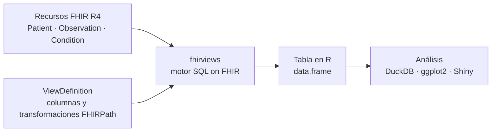
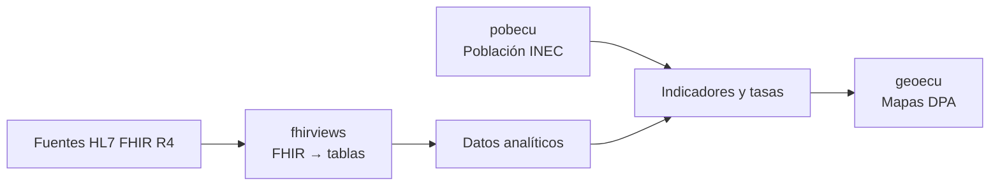

<h1 align="center">Dr. Fabricio Salas Guerrero</h1>

<p align="center"><strong>Médico epidemiólogo · Salud digital · Interoperabilidad clínica · Ingeniería de datos</strong></p>
<p align="center"><em>Epidemiologist · Open-source health data · HL7 FHIR · R &amp; SQL on FHIR</em></p>

<p align="center">
  <a href="https://www.hl7ecuador.org/">HL7 Ecuador</a> ·
  <a href="https://www.linkedin.com/in/fslg/">LinkedIn</a> ·
  <a href="https://aipocrates.blog/">AIpócrates</a> ·
  <a href="https://github.com/f-slg?tab=repositories">Código abierto</a>
</p>

---

### De datos clínicos interoperables a inteligencia territorial

Desarrollo herramientas abiertas para conectar **estándares clínicos, bases de datos, analítica y cartografía**. Mi trabajo combina epidemiología y tecnología: convertir información dispersa en datos reutilizables para investigación, vigilancia epidemiológica y decisiones en salud pública.

Presido **[HL7 Ecuador](https://www.hl7ecuador.org/)**. Aquí comparto proyectos técnicos en **R, HL7 FHIR R4, SQL on FHIR, DuckDB, `sf` y Shiny**, junto con materiales para aprender y reproducir resultados.

<p align="center">
  <a href="#proyectos-principales">Proyectos</a> ·
  <a href="#cómo-se-relacionan">Arquitectura</a> ·
  <a href="#aprendizaje-y-prototipos">Aprendizaje</a> ·
  <a href="#investigación-y-trayectoria">Investigación</a> ·
  <a href="#colaboración">Contacto</a>
</p>

## Proyectos principales

### 01 · fhirviews — HL7 FHIR → tablas analíticas

[**Repositorio**](https://github.com/f-slg/fhirviews) · [Documentación](https://f-slg.github.io/fhirviews/) · [Arquitectura](https://f-slg.github.io/fhirviews/articles/arquitectura.html) · [Pruebas de conformidad](https://f-slg.github.io/fhirviews/reference/vista_conformidad.html)

Cliente **FHIR R4** para R y herramientas de **SQL on FHIR / ViewDefinition**. Permite consultar recursos clínicos, transformarlos en tablas y trabajar con ellos en flujos analíticos reproducibles.

[](https://github.com/f-slg/fhirviews/actions/workflows/R-CMD-check.yaml)
[](https://f-slg.github.io/fhirviews/reference/vista_conformidad.html)

**Del recurso clínico a una tabla analítica:**



<sub>Esquema conceptual reproducible en Mermaid. Los recursos FHIR y la ViewDefinition son entradas independientes del motor; el resultado de conformidad publicado corresponde a pruebas de implementación, no a una certificación externa.</sub>

### 02 · geoecu — cartografía oficial como objetos sf

[**Repositorio**](https://github.com/f-slg/geoecu) · [En CRAN](https://cran.r-project.org/package=geoecu) · [Galería cartográfica](https://f-slg.github.io/geoecu/articles/galeria.html)

Capas territoriales del Ecuador por **provincia, cantón y parroquia**, con códigos de la División Político-Administrativa (DPA). Usa datos abiertos de **CONALI**, distingue zonas en estudio y permite unir indicadores propios mediante códigos DPA.

[](https://cran.r-project.org/package=geoecu)
[](https://github.com/f-slg/geoecu/actions/workflows/R-CMD-check.yaml)

| Qué ofrece | Detalle |
|---|---|
| **Tres niveles que encajan** | Cada cantón es la unión de sus parroquias y cada provincia la de sus cantones, sin huecos ni traslapes. |
| **Dos resoluciones** | `"baja"` (3 MB) para mapas y tableros; `"alta"` (39 MB) para análisis espacial. |
| **Superficie calculada sobre cartografía oficial** | `area_km2` sobre el elipsoide WGS84, con proyección de igual área. |
| **Unión con datos propios** | `geoecu_unir()` une por código DPA aunque vengan de Excel sin ceros iniciales. |
| **Códigos históricos** | `actualizar_codigo()` convierte códigos de versiones anteriores de la DPA. |
| **Sin conexión** | Descarga única, verificada con suma MD5 y guardada en caché. |

**Ecuador, de la provincia a la parroquia:** tres niveles territoriales con cartografía oficial y colores por región, cantón y tipo de parroquia.

<table>
  <thead>
    <tr>
      <th align="center" width="33%">24 provincias<br/><sub>+ 1 zona en estudio</sub></th>
      <th align="center" width="33%">223 cantones<br/><sub>+ 2 zonas en estudio</sub></th>
      <th align="center" width="34%">1.048 parroquias<br/><sub>+ 3 zonas en estudio</sub></th>
    </tr>
  </thead>
  <tbody>
    <tr>
      <td align="center">
        <a href="https://github.com/f-slg/geoecu/blob/main/man/figures/README-provincias.png">
          
        </a>
        <br/><sub>Regiones naturales</sub>
      </td>
      <td align="center">
        <a href="https://github.com/f-slg/geoecu/blob/main/man/figures/README-cantones.png">
          
        </a>
        <br/><sub>Cantones · escala temática</sub>
      </td>
      <td align="center">
        <a href="https://github.com/f-slg/geoecu/blob/main/man/figures/README-parroquias.png">
          
        </a>
        <br/><sub>Tipo de parroquia · detalle de Puyango</sub>
      </td>
    </tr>
  </tbody>
</table>

<sub>Fuente: CONALI, División Político-Administrativa. Los conteos distinguen circunscripciones y zonas en estudio. Haz clic en cada mapa para abrirlo a mayor tamaño. Galápagos se reubica solo para visualización, nunca para calcular superficies ni distancias. [Ver la galería detallada y reproducible](https://f-slg.github.io/geoecu/articles/galeria.html).</sub>

### 03 · pobecu — denominadores para indicadores de salud

[**Repositorio**](https://github.com/f-slg/pobecu) · [Documentación](https://f-slg.github.io/pobecu/) · [Metodología](https://f-slg.github.io/pobecu/articles/metodologia.html) · [Mapas con geoecu](https://f-slg.github.io/pobecu/articles/pobecu-geoecu.html)

Población del Ecuador por **provincia, cantón y parroquia**, lista para usar como denominador de tasas, coberturas e indicadores de salud. Usa las **estimaciones y proyecciones oficiales del INEC (Revisión 2024)** con los códigos DPA del Censo 2022 y se integra con `geoecu` para mapear.

[](https://github.com/f-slg/pobecu/actions/workflows/R-CMD-check.yaml)

<a href="https://github.com/f-slg/pobecu">
  
</a>

<sub>Serie nacional, pirámide por sexo y edad, y densidad cantonal. Fuente: INEC, Revisión 2024.</sub>

| Nivel | Años | Desagregación | Naturaleza |
|---|---|---|---|
| Nacional | 1950–2050 | Sexo, edad simple o quinquenal, urbano/rural (2010–2035) | Oficial INEC |
| Provincia | 1990–2035 | Sexo, edad simple o quinquenal, urbano/rural (2010–2035) | Oficial INEC |
| Cantón | 2010–2035 | Sexo, edad simple o quinquenal, urbano/rural | Oficial INEC |
| Parroquia | 2010–2035 | Sexo y edad quinquenal | Estimación propia, coherente con el total cantonal |

- **Tasas en una línea:** `pob_tasa()` une los casos con su población por territorio, año, sexo y edad, y calcula la tasa.
- **Códigos de cualquier fuente:** `homologar_parroquia()` y `homologar_canton()` llevan los códigos de parroquias urbanas y de la DPA del CONALI 2026 a las unidades del censo.
- **Auditado contra los Excel del INEC:** más de seis millones de celdas comprobadas sin diferencias ([validación reproducible](https://github.com/f-slg/pobecu/tree/main/validacion)).
- **Escenarios 1900–2100 (en desarrollo):** `pob_ajustar()` y `pob_estimar()` extienden las series territoriales con modelos estructurales amortiguados, bandas Monte Carlo y totales coherentes en toda la jerarquía.

<a href="https://github.com/f-slg/pobecu#13-reconstrucción-y-escenarios-de-población-19002100">
  
</a>

<sub>Los extremos de 1900 y 2100 son reconstrucciones y escenarios condicionados a supuestos, no cifras oficiales ni predicciones validadas. Las cifras parroquiales son estimaciones de pobecu.</sub>

## Cómo se relacionan

Los repositorios comparten una misma orientación técnica: **datos clínicos interoperables + denominadores poblacionales + geografía administrativa**.



<sub>Arquitectura conceptual de uso combinado: los paquetes son independientes y el diagrama no representa un sistema productivo único.</sub>

**Juntos, pobecu y geoecu:** población del INEC dividida por la superficie de cada territorio, de la provincia a la parroquia.

<a href="https://github.com/f-slg/geoecu#6-densidad-poblacional-provincias-cantones-y-parroquias">
  
</a>

<sub>Población 2026 del INEC (vía pobecu) / `area_km2` de geoecu. Las cifras parroquiales son estimaciones de pobecu; en gris, zonas en estudio sin población asignada.</sub>

Del registro de casos a un mapa de tasas, en pocas líneas de R:

```r
library(pobecu)   # denominadores del INEC
library(ggplot2)

casos <- data.frame(dpa_canton = c("1101", "1102", "1110"), anio = 2025,
                    casos = c(120, 8, 15))          # datos ficticios
tasas <- pob_tasa(casos, "casos", por = 1e5)        # casos por 100 000 hab.

mapa <- pob_mapa("canton", anio = 2025, provincia = "Loja")   # capa de geoecu
mapa <- merge(mapa, tasas[c("dpa_canton", "tasa")], by = "dpa_canton", all.x = TRUE)

ggplot(mapa) + geom_sf(aes(fill = tasa)) + theme_void()
```

## Aprendizaje y prototipos

| Proyecto | Para qué sirve | Recursos |
|---|---|---|
| [**Aprende FHIR**](https://github.com/f-slg/aprende-fhir) | Taller de HL7 FHIR R4 en español, por recursos, con caso clínico y ejemplos prácticos. | [Sitio del taller](https://f-slg.github.io/aprende-fhir/) |
| [**Agenda FHIR**](https://github.com/f-slg/agenda-fhir-r) | Prototipo educativo de agendamiento en R/Shiny con recursos FHIR y datos sintéticos. | [Código y demostración](https://github.com/f-slg/agenda-fhir-r) |

Los ejemplos públicos priorizan información sintética o de fuentes abiertas; los prototipos se identifican como educativos y no sustituyen validación institucional ni certificación clínica.

## Investigación y trayectoria

Mi perspectiva nace del trabajo en **vigilancia epidemiológica, salud pública e interoperabilidad**. Además del desarrollo de herramientas, participo en divulgación, docencia y espacios de articulación de salud digital.

- **HL7 Ecuador:** presidencia y promoción de estándares de interoperabilidad. [Capítulo HL7 Ecuador](https://www.hl7ecuador.org/) · [Actividad institucional](https://www.linkedin.com/company/hl7-ecuador/).
- **Universidad Nacional de Loja:** participación reseñada en el [comité científico Cienf 2026](https://unl.edu.ec/cienf2026/comite-cientifico).
- **Publicación en vigilancia epidemiológica:** Villagrán Pancho LE, **Salas Guerrero RF**, et al. *Metodología en la optimización de bases de datos de los sistemas de información en salud de Ecuador para el monitoreo en tiempo real de eventos críticos para la vigilancia epidemiológica*. **Práctica Familiar Rural** (2023). [DOI: 10.16921/pfr.v8i3.292](https://doi.org/10.16921/pfr.v8i3.292).
- **Investigación colaborativa en inmunizaciones:** Pérez-Tasigchana F, et al. (incluye a **Ronald Salas**). *Effectiveness of COVID-19 vaccines in Ecuador: A test-negative design*. **Vaccine: X** 15 (2023), 100404. [DOI: 10.1016/j.jvacx.2023.100404](https://doi.org/10.1016/j.jvacx.2023.100404) · [PubMed](https://pubmed.ncbi.nlm.nih.gov/38033879/).

<details>
<summary><strong>Formación y experiencia complementaria</strong></summary>

- Medicina y maestría en Epidemiología, Universidad Nacional de Loja.
- Formación doctoral **DBA en curso**, Walsh College, orientada a aplicaciones de IA y machine learning.
- Formación en gerencia de instituciones de salud, telemedicina, interoperabilidad y ciencia de datos.
- Estudios y capacitación en IA/ML, incluidas actividades de educación ejecutiva con UT Austin McCombs / Great Learning.
- Formación en estándares FHIR y terminologías como SNOMED CT.

Para el historial académico, cargos y certificaciones con sus fechas y estados actualizados, consulta mi [perfil profesional en LinkedIn](https://www.linkedin.com/in/fslg/).

</details>

<details>
<summary><strong>Divulgación y otros trabajos</strong></summary>

- [La interoperabilidad basada en inteligencia artificial: ¿la nueva torre de Babel?](https://aipocrates.blog/2025/03/09/la-interoperabilidad-basada-en-inteligencia-artificial-la-nueva-torre-de-babel/)
- [El médico, la IA y la autopista cuántica (Parte 1)](https://aipocrates.blog/2025/08/03/el-medico-la-ia-y-la-autopista-cuantica-repensando-el-futuro-de-la-medicina-desde-la-interoperabilidad-sistemica-parte-1-2/)
- [AIpócrates](https://aipocrates.blog/): reflexiones sobre IA, estándares y transformación de la salud.

</details>

## Colaboración

Me interesan las colaboraciones que combinen **FHIR, SQL on FHIR, R, datos públicos reproducibles e inteligencia territorial en salud**, especialmente en Latinoamérica.

Para propuestas académicas o institucionales: [LinkedIn](https://www.linkedin.com/in/fslg/). Para errores o contribuciones de código, utiliza los *Issues* y *Pull Requests* de cada repositorio.

<p align="center"><sub>Proyectos abiertos · Fuentes identificadas · Datos sintéticos en demostraciones · Documentación reproducible</sub></p>
