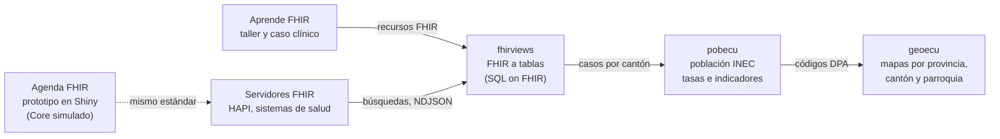

<h1 align="center">Dr. Fabricio Salas Guerrero</h1>

Médico epidemiólogo · Salud digital · Interoperabilidad · Ingeniería de datos en salud · IA

Presidente de <strong>HL7 Ecuador</strong> · <a href="https://www.linkedin.com/in/fslg/">LinkedIn</a> · <a href="https://aipocrates.blog/">AIpócrates</a>

  <a href="#proyectos">Proyectos</a> ·
  <a href="#destacado-fhirviews">fhirviews</a> ·
  <a href="#hitos">Hitos</a> ·
  <a href="#formación">Formación</a> ·
  <a href="#publicaciones">Publicaciones</a> ·
  <a href="#conectemos">Contacto</a>

---

## Sobre mí

Soy médico epidemiólogo y trabajo entre la **salud pública y la tecnología**: vigilancia epidemiológica, interoperabilidad con **HL7 FHIR**, analítica de datos e inteligencia artificial aplicada a la salud. Presido **HL7 Ecuador** y escribo en **AIpócrates**.

Aquí publico el lado práctico de ese trabajo: **paquetes de R, prototipos y talleres** documentados, que llevan un dato clínico estandarizado hasta un indicador territorial.

**Herramientas:** R · HL7 FHIR R4 · SQL on FHIR · DuckDB · Shiny · GitHub Actions

## Proyectos

| | Proyecto | Qué hace | Tecnologías |
|:---:|---|---|---|
|  | [**fhirviews**](https://github.com/f-slg/fhirviews) | Cliente FHIR R4 para R y motor de **SQL on FHIR** (`ViewDefinition`) que convierte recursos en tablas, sin Java ni Spark. 133/133 pruebas *shareable* del banco oficial. | R, FHIR R4, SQL on FHIR, FHIRPath, DuckDB |
|  | [**geoecu**](https://github.com/f-slg/geoecu)    | **En CRAN.** Capas de provincias, cantones y parroquias del Ecuador (códigos DPA) como objetos `sf`, a partir de datos abiertos de CONALI. `install.packages("geoecu")` | R, sf, ggplot2 |
|  | [**pobecu**](https://github.com/f-slg/pobecu) | Población del Ecuador por provincia, cantón y parroquia (INEC, 1950-2050) para calcular tasas, coberturas e indicadores. | R, sf, ggplot2 |
|  | [**Aprende FHIR**](https://github.com/f-slg/aprende-fhir) | Taller de FHIR R4 en español, paso a paso, con un caso clínico ecuatoriano. Para Postman, R o curl. | FHIR R4, Postman, R |
|  | [**Agenda FHIR**](https://github.com/f-slg/agenda-fhir-r) | Prototipo educativo de agendamiento y atención clínica con FHIR TEAM, datos sintéticos y un Core simulado. | R, Shiny, FHIR R4 |

Los proyectos encajan en un solo flujo, del dato clínico al mapa:

geoecu y pobecu comparten los códigos de la División Político-Administrativa, así que con pocas líneas se obtiene un mapa de tasas por cantón o parroquia. Con fhirviews, los datos de un servidor FHIR se convierten en las tablas de casos que pobecu necesita.

## Destacado: fhirviews

**fhirviews** lleva **HL7 FHIR R4** a R: consulta cualquier servidor FHIR desde RStudio, al estilo de Postman, y convierte los recursos en `data.frame` con el estándar [SQL on FHIR](https://sql-on-fhir.org/).

- **Conforme al estándar:** 133 pruebas *shareable* del banco oficial en cada ejecución de integración continua.
- **Del servidor a la tabla:** búsqueda con paginación, lectura y escritura, transacciones, `$everything`, `$validate` y exportación masiva con `$export`.
- **Listo para producción:** SMART on FHIR / OAuth2 (*client credentials*, *Backend Services* con JWT, inicio de sesión en navegador).
- **Grandes volúmenes:** un segundo motor traduce las vistas a SQL de DuckDB y procesa un millón de pacientes en unos 6 segundos en un portátil.
- **Salud pública:** catálogo de vistas estándar (residencia, signos vitales, diagnósticos CIE-10/SNOMED CT, notificación obligatoria, inmunizaciones) y terminologías (`$expand`, `$lookup`, `$validate-code`).

[Repositorio](https://github.com/f-slg/fhirviews) · [Documentación](https://f-slg.github.io/fhirviews/) · [Cómo funciona por dentro](https://f-slg.github.io/fhirviews/articles/arquitectura.html) · [Releases](https://github.com/f-slg/fhirviews/releases)

## Hitos

- 🏆 **Conectatón ESAVI-FHIR de OPS (Bogotá, 2023):** el equipo de Ecuador obtuvo el primer lugar al reportar eventos supuestamente atribuibles a la vacunación o inmunización con el estándar FHIR. [Nota del Ministerio de Salud](https://www.salud.gob.ec/?p=80038).
- 🌎 **Consultor de OPS** en inmunizaciones (vacunación COVID-19) y en la integración de datos de arbovirus para el sistema integrado de vigilancia epidemiológica (SIVE).
- 🏛️ **Comisión Intersectorial de Salud Digital:** delegación del Ministro de Salud, junto con el CONASA, para coordinar con las instituciones de la RPIS y la RPC las políticas de salud digital.
- 🧭 **Presidente de HL7 Ecuador:** formación y adopción de estándares de información en salud. Mi contribución figura en [State of FHIR 2026](https://simplifier.net/jurisdictions/EC).
- 🎓 **Docencia y ponencias** sobre interoperabilidad, HL7 FHIR, SNOMED CT e IA en salud ([Universidad de Cuenca, 2026](https://www.ucuenca.edu.ec/wp-content/uploads/2026/05/CRONOGRAMA-FINAL-2.2.pdf)).
- 🤝 **Miembro de AIpócrates** y de la Organización Internacional de Telemedicina y Telesalud.

<strong>Formación</strong>

 

| Formación | Institución | Estado |
|---|---|---|
| Médico General | Universidad Nacional de Loja | 2018 |
| Magíster en Epidemiología | Universidad Nacional de Loja | 2025 |
| Doctor en Inteligencia Artificial y Machine Learning (DBA) | Walsh College | En curso |
| Postgrado en IA y Machine Learning (certificado de educación ejecutiva) | UT Austin McCombs / Great Learning | Completado (2025) |
| Maestría en Gerencia de Instituciones de Salud | Escuela de Posgrado Newman | En proceso de titulación |
| Maestría en Inteligencia Artificial | Escuela de Posgrado Newman | En proceso de titulación |
| Diplomado en Telemedicina y TI en Salud | Universidad de Concepción (Chile) | 2020 |
| Diplomado en Ciencia de Datos (160 h) | ESAP (Colombia) | 2022 |
| Programa de especialización en Salud Digital | C-DAC (India), cooperación ITEC | 2025 |

Certificaciones técnicas: fundamentos de interoperabilidad **HL7 International** y fundamentos de **SNOMED CT**; capacitación en **R** (Ministerio de Salud Pública y Sociedad Ecuatoriana de Estadística). Más detalle en [LinkedIn](https://www.linkedin.com/in/fslg/).

<strong>Publicaciones</strong>

 

**Artículos científicos**

- Villagrán Pancho LE, **Salas Guerrero RF**, Rivadeneira Malla YK, Cagua Ordoñez JC, Pérez-Tasigchana RF, Simancas-Racines D, Bejarano Sandoval A. *Metodología en la optimización de bases de datos de los sistemas de información en salud de Ecuador para el monitoreo en tiempo real de eventos críticos para la vigilancia epidemiológica. Reporte de implementación.* Práctica Familiar Rural, 2023; 8(3). [DOI 10.16921/pfr.v8i3.292](https://doi.org/10.16921/pfr.v8i3.292)
- Ludeña T, Lozano-Samaniego A, Maldonado S, **Salas F**. *El hilio pulmonar: dos signos radiológicos clásicos para descifrarlo.* Radiología, 2020. [DOI 10.1016/j.rx.2020.09.005](https://doi.org/10.1016/j.rx.2020.09.005)
- Lozano A, Carrillo D, Maldonado S, **Salas F**. *Rendimiento diagnóstico de la tomografía computarizada de tórax en los primeros 422 pacientes con sospecha clínica de COVID-19.* Revista de la Federación Ecuatoriana de Radiología, 2021; 14(2).
- Pérez-Tasigchana F, et al. (incluye a Salas R). *Effectiveness of COVID-19 vaccines in Ecuador: a test-negative design.* <!-- COMPLETAR: revista, año y DOI -->

**Divulgación en AIpócrates**

- [La interoperabilidad basada en inteligencia artificial: ¿la nueva torre de Babel?](https://aipocrates.blog/2025/03/09/la-interoperabilidad-basada-en-inteligencia-artificial-la-nueva-torre-de-babel/)
- [El médico, la IA y la autopista cuántica, Parte 1](https://aipocrates.blog/2025/08/03/el-medico-la-ia-y-la-autopista-cuantica-repensando-el-futuro-de-la-medicina-desde-la-interoperabilidad-sistemica-parte-1-2/)

## Calidad y documentación

Los paquetes de R (geoecu, pobecu y fhirviews) incluyen pruebas automáticas en Windows, macOS y Linux, sitio de documentación con pkgdown y notas sobre las fuentes de datos.

## Conectemos

Me interesa el cruce entre medicina, epidemiología, gestión e informática en salud. Escríbeme por [LinkedIn](https://www.linkedin.com/in/fslg/) o abre un *issue* en el repositorio correspondiente. Las colaboraciones sobre FHIR, SQL on FHIR y datos territoriales son bienvenidas.
