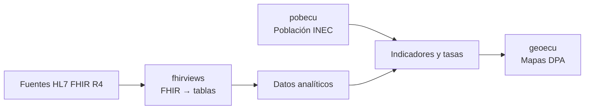

<h1 align="center">Dr. Fabricio Salas Guerrero</h1>

<strong>Médico epidemiólogo · Salud digital · Interoperabilidad clínica · Ingeniería de datos</strong>

<em>Epidemiologist · Open-source health data · HL7 FHIR · R &amp; SQL on FHIR</em>

  <a href="https://www.hl7ecuador.org/">HL7 Ecuador</a> ·
  <a href="https://www.linkedin.com/in/fslg/">LinkedIn</a> ·
  <a href="https://aipocrates.blog/">AIpócrates</a> ·
  <a href="https://github.com/f-slg?tab=repositories">Código abierto</a>

---

### De datos clínicos interoperables a inteligencia territorial

Desarrollo herramientas abiertas para conectar **estándares clínicos, bases de datos, analítica y cartografía**. Mi trabajo combina epidemiología y tecnología: convertir información dispersa en datos reutilizables para investigación, vigilancia epidemiológica y decisiones en salud pública.

Presido **[HL7 Ecuador](https://www.hl7ecuador.org/)**. Aquí comparto proyectos técnicos en **R, HL7 FHIR R4, SQL on FHIR, DuckDB, `sf` y Shiny**, junto con materiales para aprender y reproducir resultados.

  <a href="#proyectos-principales">Proyectos</a> ·
  <a href="#cómo-se-relacionan">Arquitectura</a> ·
  <a href="#aprendizaje-y-prototipos">Aprendizaje</a> ·
  <a href="#investigación-y-trayectoria">Investigación</a> ·
  

## Proyectos principales

### 01 · fhirviews — HL7 FHIR → tablas analíticas

[**Repositorio**](https://github.com/f-slg/fhirviews) · [Documentación](https://f-slg.github.io/fhirviews/) · [Arquitectura](https://f-slg.github.io/fhirviews/articles/arquitectura.html) · [Pruebas de conformidad](https://f-slg.github.io/fhirviews/reference/vista_conformidad.html)

Cliente **FHIR R4** para R y herramientas de **SQL on FHIR / ViewDefinition**. Permite consultar recursos clínicos, transformarlos en tablas y trabajar con ellos en flujos analíticos reproducibles.

Ilustración generada por el proyecto. El resultado de conformidad corresponde a su conjunto publicado de pruebas; no implica certificación externa.

### 02 · geoecu — cartografía oficial como objetos sf

[**Repositorio**](https://github.com/f-slg/geoecu) · [En CRAN](https://cran.r-project.org/package=geoecu) · [Galería cartográfica](https://f-slg.github.io/geoecu/articles/galeria.html)

Capas territoriales del Ecuador por **provincia, cantón y parroquia**, con códigos de la División Político-Administrativa (DPA). Usa datos abiertos de **CONALI**, distingue zonas en estudio y permite unir indicadores propios mediante códigos DPA.

Datos cartográficos: CONALI. Las geometrías de Galápagos se reubican únicamente para presentación, no para mediciones.

### 03 · pobecu — denominadores para indicadores de salud

[**Repositorio**](https://github.com/f-slg/pobecu) · [Documentación](https://f-slg.github.io/pobecu/)

Herramientas de población del Ecuador con desagregación territorial y códigos DPA, basadas en datos del **INEC**. Diseñado para trabajar con denominadores de tasas, coberturas y otros indicadores, junto con `geoecu`.

Las estimaciones y proyecciones deben interpretarse según su año, fuente y metodología de origen.

## Cómo se relacionan

Los repositorios comparten una misma orientación técnica: **datos clínicos interoperables + denominadores poblacionales + geografía administrativa**.

Arquitectura conceptual de uso combinado: los paquetes son independientes y el diagrama no representa un sistema productivo único.

## Aprendizaje y prototipos

| Proyecto | Para qué sirve | Recursos |
|---|---|---|
| [**Aprende FHIR**](https://github.com/f-slg/aprende-fhir) | Taller de HL7 FHIR R4 en español, por recursos, con caso clínico y ejemplos prácticos. | [Sitio del taller](https://f-slg.github.io/aprende-fhir/) |
| [**Agenda FHIR**](https://github.com/f-slg/agenda-fhir-r) | Prototipo educativo de agendamiento en R/Shiny con recursos FHIR y datos sintéticos. | [Código y demostración](https://github.com/f-slg/agenda-fhir-r) |

Los ejemplos públicos priorizan información sintética o de fuentes abiertas; los prototipos se identifican como educativos y no sustituyen validación institucional ni certificación clínica.

## Investigación y trayectoria

Mi perspectiva nace del trabajo en **vigilancia epidemiológica, salud pública e interoperabilidad**. Además del desarrollo de herramientas, participo en divulgación, docencia y espacios de articulación de salud digital.

- **HL7 Ecuador:** presidencia y promoción de estándares de interoperabilidad. [Capítulo HL7 Ecuador](https://www.hl7ecuador.org/) · [Actividad institucional](https://www.linkedin.com/company/hl7-ecuador/).
- **Universidad Nacional de Loja:** participación reseñada en el [comité científico Cienf 2026](https://unl.edu.ec/cienf2026/comite-cientifico).
- **Publicación en vigilancia epidemiológica:** Villagrán Pancho LE, **Salas Guerrero RF**, et al. *Metodología en la optimización de bases de datos de los sistemas de información en salud de Ecuador para el monitoreo en tiempo real de eventos críticos para la vigilancia epidemiológica*. **Práctica Familiar Rural** (2023). [DOI: 10.16921/pfr.v8i3.292](https://doi.org/10.16921/pfr.v8i3.292).
- **Investigación colaborativa en inmunizaciones:** Pérez-Tasigchana F, et al. (incluye a **Ronald Salas**). *Effectiveness of COVID-19 vaccines in Ecuador: A test-negative design*. **Vaccine: X** 15 (2023), 100404. [DOI: 10.1016/j.jvacx.2023.100404](https://doi.org/10.1016/j.jvacx.2023.100404) · [PubMed](https://pubmed.ncbi.nlm.nih.gov/38033879/).

<strong>Formación y experiencia complementaria</strong>

- Medicina y maestría en Epidemiología, Universidad Nacional de Loja.
- Formación doctoral **DBA en curso**, Walsh College, orientada a aplicaciones de IA y machine learning.
- Formación en gerencia de instituciones de salud, telemedicina, interoperabilidad y ciencia de datos.
- Estudios y capacitación en IA/ML, incluidas actividades de educación ejecutiva con UT Austin McCombs / Great Learning.
- Formación en estándares FHIR y terminologías como SNOMED CT.

Para el historial académico, cargos y certificaciones con sus fechas y estados actualizados, consulta mi [perfil profesional en LinkedIn](https://www.linkedin.com/in/fslg/).

<strong>Divulgación y otros trabajos</strong>

- [La interoperabilidad basada en inteligencia artificial: ¿la nueva torre de Babel?](https://aipocrates.blog/2025/03/09/la-interoperabilidad-basada-en-inteligencia-artificial-la-nueva-torre-de-babel/)
- [El médico, la IA y la autopista cuántica (Parte 1)](https://aipocrates.blog/2025/08/03/el-medico-la-ia-y-la-autopista-cuantica-repensando-el-futuro-de-la-medicina-desde-la-interoperabilidad-sistemica-parte-1-2/)
- [AIpócrates](https://aipocrates.blog/): reflexiones sobre IA, estándares y transformación de la salud.

## Colaboración

Me interesan las colaboraciones que combinen **FHIR, SQL on FHIR, R, datos públicos reproducibles e inteligencia territorial en salud**, especialmente en Latinoamérica.

Para propuestas académicas o institucionales: [LinkedIn](https://www.linkedin.com/in/fslg/). Para errores o contribuciones de código, utiliza los *Issues* y *Pull Requests* de cada repositorio.

Proyectos abiertos · Fuentes identificadas · Datos sintéticos en demostraciones · Documentación reproducible

