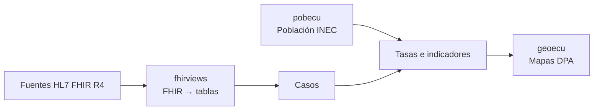

<h1 align="center">Dr. Fabricio Salas Guerrero</h1>

<p align="center"><strong>Médico epidemiólogo que une clínica, datos e inteligencia artificial</strong></p>
<p align="center"><sub>HL7 FHIR · SNOMED CT · LOINC · CIE-11 · DICOM · IHE · openEHR · GS1 Healthcare</sub></p>

<p align="center"><strong>Español</strong> · <a href="https://github.com/f-slg/f-slg/blob/main/README.en.md">English</a></p>

<p align="center">
  <a href="https://www.hl7ecuador.org/">HL7 Ecuador</a> ·
  <a href="https://www.linkedin.com/in/fslg/">LinkedIn</a> ·
  <a href="https://aipocrates.blog/">AIpócrates</a>
</p>

---

Presido **[HL7 Ecuador](https://www.hl7ecuador.org/)** y trabajo en vigilancia epidemiológica en el Ministerio de Salud Pública. Construyo herramientas abiertas para que los datos de salud sean **interoperables y reproducibles**: de los estándares clínicos (FHIR, FSH, SQL on FHIR) a la ingeniería de datos (PostgreSQL, DuckDB, Python) y la analítica (R, Shiny, Quarto).

## Paquetes de R

| Paquete | Para qué sirve | Estado |
|---|---|---|
| [**fhirviews**](https://github.com/f-slg/fhirviews) · [docs](https://f-slg.github.io/fhirviews/) | Cliente HL7 FHIR R4 y motor SQL on FHIR (`ViewDefinition`, FHIRPath) que convierte recursos clínicos en tablas. Supera las 133 pruebas *shareable* de la suite oficial (resultado de pruebas, no certificación). | **Enviado a CRAN** (v0.5.0)<br> [](https://github.com/f-slg/fhirviews/actions/workflows/R-CMD-check.yaml) [](https://f-slg.github.io/fhirviews/reference/vista_conformidad.html) |
| [**geoecu**](https://github.com/f-slg/geoecu) · [docs](https://f-slg.github.io/geoecu/) | Las 24 provincias, 223 cantones y 1.048 parroquias del Ecuador como objetos `sf`, con códigos DPA del CONALI. | **En CRAN** (v0.4.1)<br> [](https://cran.r-project.org/package=geoecu) [](https://github.com/f-slg/geoecu/actions/workflows/R-CMD-check.yaml) |
| [**pobecu**](https://github.com/f-slg/pobecu) · [docs](https://f-slg.github.io/pobecu/) | Población del INEC (Revisión 2024) por provincia, cantón y parroquia, lista para usar como denominador de tasas. | **En CRAN** (v0.3.0)<br> [](https://cran.r-project.org/package=pobecu) [](https://github.com/f-slg/pobecu/actions/workflows/R-CMD-check.yaml) |

Son independientes, pero están pensados para usarse juntos: **del registro de casos a un mapa de tasas** ([ejemplo completo y reproducible](https://f-slg.github.io/fhirviews/articles/tasas-pobecu.html)).



```r
# install.packages(c("pobecu", "geoecu", "sf", "ggplot2"))   # desde CRAN
library(pobecu)
library(ggplot2)

casos <- data.frame(dpa_canton = c("1101", "1102", "1110"), anio = 2025,
                    casos = c(120, 8, 15))          # datos ficticios
tasas <- pob_tasa(casos, "casos", por = 1e5)        # casos por 100 000 hab.

mapa <- pob_mapa("canton", anio = 2025, provincia = "Loja")   # capa de geoecu
mapa <- merge(mapa, tasas[c("dpa_canton", "tasa")], by = "dpa_canton", all.x = TRUE)

ggplot(mapa) + geom_sf(aes(fill = tasa)) + theme_void()
```

<a href="https://github.com/f-slg/geoecu#6-densidad-poblacional-provincias-cantones-y-parroquias">
  
</a>

<sub>Densidad poblacional 2026: población del INEC (vía pobecu) / `area_km2` de geoecu. Límites: CONALI (CC BY).</sub>

## Aprendizaje y prototipos

- [**Aprende FHIR**](https://github.com/f-slg/aprende-fhir) · [sitio](https://f-slg.github.io/aprende-fhir/): taller de HL7 FHIR R4 en español, con un caso clínico ecuatoriano, para Postman, R o curl.
- [**Agenda FHIR**](https://github.com/f-slg/agenda-fhir-r): prototipo educativo de agenda clínica en R/Shiny, construido con Catherine Solarte Godoy y Néstor Fabián López en el FHIR Camp de HL7 Colombia.
- [**Sala de inmunizaciones del Perú**](https://github.com/f-slg/sala-inmunizaciones-peru): sala situacional educativa en R/Shiny y golem.

Los ejemplos públicos usan datos sintéticos o de fuentes abiertas.

## Trabajo institucional

Buena parte de mi trabajo está en repositorios privados: guías de implementación **HL7 FHIR R4 para Ecuador** en FSH (en borrador), una plataforma de **vigilancia epidemiológica basada en estándares** (HAPI FHIR, Kafka), la vigilancia de **infecciones asociadas a la atención en salud y brotes** (ETL *medallion* en PostgreSQL, tableros Shiny) y un libro abierto en preparación, *Ciencia de datos con R para la salud pública*.

## Trayectoria

- **HL7 Ecuador:** presidente desde 2025.
- **Ministerio de Salud Pública del Ecuador:** médico epidemiólogo y analista de datos en vigilancia epidemiológica nacional.
- **Docencia de posgrado** en informática médica y analítica de datos (Universidad UTE, Universidad Continental, IAEN).
- **Doctorado en Inteligencia Artificial y *Machine Learning*** en curso, Walsh College (2025–2028).
- **Publicaciones:** [optimización de bases de datos para vigilancia epidemiológica](https://doi.org/10.16921/pfr.v8i3.292) (*Práctica Familiar Rural*, 2023) · [efectividad de las vacunas contra la COVID-19 en Ecuador](https://doi.org/10.1016/j.jvacx.2023.100404) (*Vaccine: X*, 2023).

## Colaboración

Me interesan colaboraciones sobre **FHIR, SQL on FHIR, R y datos públicos reproducibles en salud**, especialmente en Latinoamérica. Propuestas académicas o institucionales: [LinkedIn](https://www.linkedin.com/in/fslg/). Errores o contribuciones: *Issues* y *Pull Requests* de cada repositorio, en español o en inglés.
